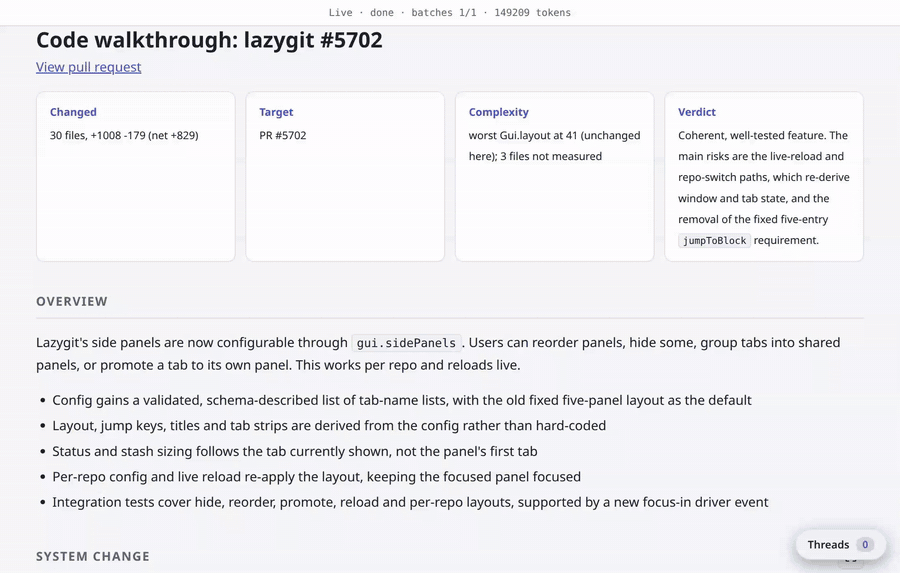

# crisperity-skills

Agent skills I use on real work, packaged so you can install them. One so far,
code-walkthrough.

## code-walkthrough

Turns a diff, a PR, or a part of the codebase you want explained into a page
you read top down, from the big picture to the exact lines.



The page above is one `/code-walkthrough` run on lazygit PR
[#5702](https://github.com/jesseduffield/lazygit/pull/5702), "Make the side
panels configurable": 30 files, +1008 -179. Select text on it and click Ask to
question the agent in place; ask it to draw any diagram and it adds one to the
page.

```
/code-walkthrough                          # working tree plus staged changes
/code-walkthrough this branch              # main...HEAD
/code-walkthrough 123                      # that PR
/code-walkthrough HEAD~3..HEAD
/code-walkthrough explain the auth flow    # code as it stands, no change needed
```

### Why

Agents write code faster than anyone can read it now, so reading and
responding is the bottleneck, not writing. A unified diff is a bad surface to
read on. It hands you 30 files in alphabetical order and leaves you to build
the picture yourself, bottom up.

When you explain a change to someone, you say what it does, then the steps it
takes, then what it touches, and only then point at lines. code-walkthrough
builds the page in that order, so by the time you reach a line of code you
already know where it sits.

### Top down, one question per level

1. **Overview: what changed, and why.** Two sentences and a few bullets, no
   file names. On the example: lazygit's side panels stop being a fixed five
   and become a list you configure.
2. **The PR in one picture, then one per theme.** The files grouped into three
   to five themes. A model draws one picture of the change and one per theme,
   from real names and numbers in the diff; a docs-only change may get none.
3. **Call graph: how far does it reach.** The call graph, under "All symbols", resolved
   by the compiler or a language server, at package and symbol level. That
   shows the blast radius: which new function is called from everywhere and
   which is a leaf.
4. **Code: the lines, with the reason beside them.** Each file gets a one line
   role and each hunk a note on what the code does. Inside a theme, callers
   come before callees.
5. **Respond: send it back.** Select any text and click Ask to question the
   agent in place. It answers in a thread, and can add or replace a block on
   the page, such as a sequence diagram; the edit is local and Undo removes it.
   Threads are read-only by default. A proposed task has Hand to my session,
   which passes it to your own Claude Code. Copy gh command prints the calls
   to post your comments as PR review comments. Nothing is posted to the PR
   unless you do it from the page, and the page is a local file that only gets
   hosted if you ask.

Changed `.md` files and images have a Preview button that swaps the diff for
the rendered file. If you work something out in your head on every review that
could live on this page, [open an issue](https://github.com/crisperity/crisperity-skills/issues).

### What a run costs

Live mode is the default. On the example PR a build took about 2 minutes and
149k tokens, and each question you ask adds a few tens of thousands more.
Without live mode the skill falls back to parallel Sonnet subagents; the same
PR took about 7 minutes and 490k tokens there. The graphs come from parsers
and take seconds either way.

Live mode runs through a daemon. By default, after running `setup`, that's
your own Claude Code: whatever account it uses, subscription, API key, or a
gateway, and it counts against that same account. Point it at any
OpenAI-compatible backend instead and it bills per token against that
backend's own API key.

Live mode sends diff hunks, the files the agent reads and your questions to
that backend. Only a model on your own machine (Ollama, vLLM) keeps them
local. Threads can't edit files unless you trust the repo, from the Threads
panel or `trust.repos` in the config; see `skills/code-walkthrough/references/live.md`.

### Prerequisites

- `python3`, standard library only, nothing to install
- `git`
- `gh`, only to target a PR or post comments
- optional, for the graphs: `tree-sitter-language-pack`, `go`, or a language
  server, depending on the language. See below.
- optional, for live mode: one `python3 skills/code-walkthrough/scripts/cw_mcp.py setup`
  run after installing. `/code-walkthrough` does it for you when live mode is
  missing. Details in `skills/code-walkthrough/references/setup.md`.

### Language support

Everything built from the diff itself works in any language: the grouping and
reading order, the annotated walkthrough, per-line comments and the
pictures.

The graphs have to parse the code:

| Language | What you need |
|---|---|
| Python, Go, JavaScript, TypeScript | nothing |
| Rust, Java, Ruby, Kotlin, Swift, Scala, C, C++, C#, PHP, Lua, Elixir, Julia | `pip install tree-sitter-language-pack` |
| Interactive symbol graph | `go` for Go; `pyright-langserver`, `typescript-language-server` or `rust-analyzer` for Python, TypeScript, Rust |

Where a parser is missing the graph sections are skipped and the page says so,
nothing else changes.

## Install

<details>
<summary><strong>Claude Code</strong></summary>

```
/plugin marketplace add crisperity/crisperity-skills
/plugin install crisperity-skills@crisperity
```

</details>

<details>
<summary><strong>Any other harness</strong></summary>

A skill is a directory with a `SKILL.md` in it, so anything that reads that
format picks it up.

```bash
git clone https://github.com/crisperity/crisperity-skills.git
cd crisperity-skills
./install.sh                            # ~/.claude/skills
./install.sh ~/.config/some-harness/skills
```

`install.sh` symlinks rather than copies, so `git pull` updates what you have
installed.

</details>

## License

MIT
